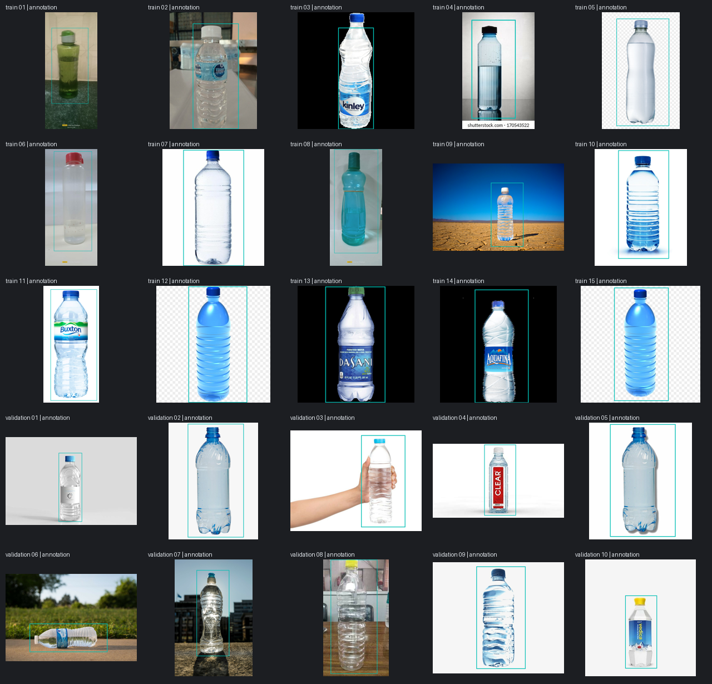
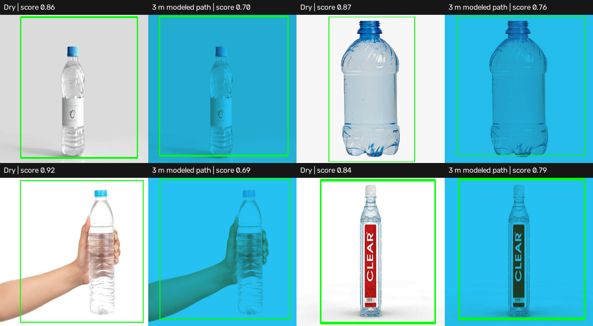

# interview-bottle

**A 2023 interview task, re-examined through the files it left behind.**

The preserved BRACU Duburi entry task was to train an object detector. I used a
Kaggle water-bottle dataset, LabelImg and SSD MobileNet v2 through the TensorFlow
Object Detection API. The screenshots are dated 3 December 2023; that archive
date is not being used to infer the date of joining the team.

The original README calls the model “320×320,” as does the upstream recipe's
name. The upstream recipe and both preserved pipeline configurations actually
declare a **300×300** fixed-shape resizer. A recipe name is not a substitute for
reading the configuration.


*December 2023. “Bottle: 0.88.” The rectangle is much wider than the bottle.
The class score does not measure how well that rectangle fits.*

The original README, with all seven screenshots, is kept in
[`README-2023.md`](README-2023.md). This repo re-opens the box with everything
the 2023 workspace left behind: the TensorBoard logs, the exported model and
the TFRecords.

<details>
<summary>Inspect every training and validation record</summary>



The first three rows are training, the last two validation. Teal boxes are
stored annotations, not detector output. This view preserves the mixed
backgrounds, mostly upright training bottles and the horizontal validation
bottle. It does not turn those conditions into an isolated causal test.
Photographs come from the original Kaggle collection, not my camera.

</details>

## What the logs remember


- **15 training images and 10 validation images** in the preserved records.
  The 15-image “test” file does not add independent data.
- **4,200 steps in the top-level loss trace**, against 50,000 configured.
  A later nested `train/train` trace reaches 1,200 steps. These surviving
  attempts are not a complete training-run manifest.
- **A large batch-size change with an inherited schedule.** The upstream
  recipe pairs a base learning rate of 0.8 with a batch of 512 and eight
  replicas. The preserved task configuration uses batch eight while retaining
  the schedule and replica settings.

The linear batch-scaling heuristic suggests `0.8 × 8 / 512 = 0.0125` as a
candidate to test. It does **not** prove that every update was exactly 64 times
too large. The replay reads a final logged learning rate of 0.796 and
regularization loss rising from about 0.320 to 0.934. Those observations make
the schedule worth investigating; they do not isolate its causal effect.

## The grade

`firstbottle/evaluate.py` re-scores the exported model. The first thing it
found was that the original test split isn't one:

> **`test.tfrecord` is a byte-for-byte copy of `train.tfrecord`.** The file
> hashes match, and all 15 decoded test images occur in training.

The ten validation images have no exact decoded-pixel matches in training.
This is a better held-out image check, not proof of independent scenes or
product sources.

| Evaluation record | AP@0.5 | Interpretation |
| --- | ---: | --- |
| Re-grade on duplicated “test” | 1.000 | Training-image performance |
| Re-grade on validation | **0.405** | Current held-out image evaluation |
| Historical evaluation log, step 4000 | 0.506 | A recorded COCO-evaluator result |

The re-grade implements **VOC-style all-point interpolated AP at IoU 0.5**.
The preserved training configuration selects the TensorFlow Object Detection
API's COCO evaluator. `ckpt-5` carries step 4000; the exported checkpoint has
no step variable. Without reconciling evaluated weights and protocol, the
0.506-to-0.405 difference is not evidence of deterioration over time.

## Confidence and overlap are different questions

| Box population | Median share of image area |
| --- | ---: |
| Top predicted box, validation | **72%** |
| Largest annotated box, validation | 31% |
| Largest annotated box, training | 51% |

These are separate medians, not a measured IoU for one pair of boxes. They
are consistent with broad-box or framing bias, but do not prove which
internal shortcut the detector learned.

For an illustrative fully contained annotation covering 31% of the image
inside a prediction covering 72%, IoU is `0.31 / 0.72 ≈ 0.431`. The original
`iou` function reproduces that geometry on constructed boxes. A rectangle can
contain the bottle and still fail the 0.5 matching requirement.

The evaluator collects detections down to score 0.01, sorts by score and
counts an annotation at most once. Duplicate detections can be false
positives. The image sheet draws only the top box above 0.3: its display
threshold does not reconstruct the metric.

The old training configuration also uses IoU in other roles: an anchor
matcher's threshold of 0.5, with forced matches, and NMS at 0.6 between
predictions. NMS does not compare detections with ground truth.

## Would it have survived the pool?

The validation photographs pass through the same defined RGB attenuation
and veil transform as [green-at-depth](https://github.com/fh1m/green-at-depth):

```text
I(channel, d) = J(channel) × exp(−k(channel) × d)
                + A(channel) × (1 − exp(−k(channel) × d))
```

The source uses pure-water absorption coefficients multiplied by four.
`d` is a modeled optical water path, not automatically vehicle depth.

| water path | 0 m | 1 m | 2 m | 3 m | 5 m | 8 m |
|---|---:|---:|---:|---:|---:|---:|
| AP@0.5, validation | 0.405 | 0.538 | 0.372 | 0.224 | 0.160 | 0.109 |

The one-metre result exceeds the dry score on these ten images. That is not
evidence that adding water generally helps this detector: transforms can
change ranking and box decisions, and no uncertainty bounds are reported.
The [original sweep plot](assets/ap_vs_depth.png) is retained separately.



Caption bands are outside the image area, so white labels no longer disappear
against white product backgrounds. This is a re-render of the same model and
inputs, not retraining. The [original sheet](assets/dry_vs_3m.png) is preserved.

The red CLEAR label darkens and changes colour under the transform. These
remain product photographs, not underwater recordings. The code operates on
encoded RGB without a calibrated camera-radiance model; it does not reproduce
refraction, bubbles, motion blur or the full scattering and lighting of a
real pool. This is an image-domain stress test, not field validation.

## What I'd change, and haven't

[`workspace/models/ssd_mobilenet/pipeline.fixed.config`](workspace/models/ssd_mobilenet/pipeline.fixed.config)
is the 2023 config with the fixes this repo argues for. **It has not been
retrained.** The numbers above are all from the 2023 model.

1. A lower candidate learning rate, shorter warm-up and training schedule,
   and single-device replica settings. Their effect remains unmeasured.
2. Exclude the duplicated test file from generalization claims while retaining
   it as an audit artifact. Validation can guide development; a final test
   needs new labelled scenes and a documented split rule.
3. Add padding and colour augmentation to test sensitivity to small,
   off-centre bottles and appearance changes. The original already flipped
   and cropped images. No gain from the proposed additions is claimed.
4. Use relative paths rather than the old machine-local paths. The preserved
   training configuration also fine-tunes from an earlier `ckpt-5`; preserve
   that starting-point provenance when designing a new comparison.

## Run it

Python 3.12 was verified with TensorFlow 2.21.0 on CPU:

```bash
python3.12 -m venv .venv
.venv/bin/python -m pip install -r requirements.txt
.venv/bin/python -m firstbottle.evaluate  # prints results and rewrites assets/*.png
.venv/bin/python -m firstbottle.data_gallery  # all records and annotations; no detector load
```

The dated [verification receipt](results/regrade-2026-11-19.json) records a
fresh replay of the original model, TFRecord hashes, exact-image overlap
checks, surviving training traces and the controlled IoU example. Verification
plots were directed outside the checkout so the existing committed images
were not overwritten. The model was not retrained.

For a new training comparison, hold the initial weights, data partition and
evaluator fixed, change the schedule or augmentation deliberately, then
report localization errors and false positives alongside AP. Repeatedly
tuning on these ten validation images would make them a development set,
not a final independent test.

### Audit the split without loading the detector

```bash
.venv/bin/python - <<'PY'
import hashlib
import numpy as np
from firstbottle.evaluate import WS, load_split, events

train = load_split("train")
validation = load_split("validation")
test = load_split("test")
for name in ("train", "validation", "test"):
    path = WS / "data" / f"{name}.tfrecord"
    print(name, hashlib.sha256(path.read_bytes()).hexdigest())
for name, split in (("validation", validation), ("test", test)):
    matches = sum(any(np.array_equal(image, previous)
                      for previous, _ in train) for image, _ in split)
    print(name, "exact pixel matches in training:", matches)
for pattern in ("models/ssd_mobilenet/train/events*",
                "models/ssd_mobilenet/train/train/events*"):
    samples = events(pattern).get("Loss/total_loss", [])
    print(pattern, "maximum logged loss step:",
          max((step for step, _ in samples), default=None))
PY
```

Exact equality is a useful first check, not a near-duplicate or scene-grouping
audit. Shared products and photographic conventions can cross the split even
when the pixels differ.

## Layout

```
workspace/exported_models/ssd_mobilenet/   the 2023 model, as exported
workspace/models/ssd_mobilenet/            checkpoints, TensorBoard logs, configs
workspace/data/                            the TFRecords (and the label map)
workspace/test.py                          the 2023 inference script
firstbottle/evaluate.py                    the re-grade
assets/Results/                            the 2023 screenshots
README-2023.md                             the 2023 README
```

The TensorFlow model garden, cocoapi, protoc and the zoo checkpoint used to be
committed here too (~170 MB of other people's code). They're upstream's to
host: see the [TF2 Object Detection API install guide](https://github.com/tensorflow/models/blob/master/research/object_detection/g3doc/tf2.md).

## Sources behind the interpretation

- [Original task and dataset attribution](README-2023.md): the historical
  submission is preserved rather than rewritten into the re-analysis.
- [Upstream TensorFlow training recipe](https://github.com/tensorflow/models/blob/master/research/object_detection/configs/tf2/ssd_mobilenet_v2_320x320_coco17_tpu-8.config):
  the named recipe's 300×300 resizer, batch 512, base learning rate 0.8 and
  replica settings.
- [Goyal et al., Accurate, Large Minibatch SGD](https://arxiv.org/abs/1706.02677):
  the ImageNet setting behind the linear-scaling and warm-up argument, not
  proof that a particular smaller fine-tuning run has one uniquely correct rate.
- [The evaluator](firstbottle/evaluate.py): the actual AP interpolation,
  score cutoffs, box matching and RGB water transform used here.
