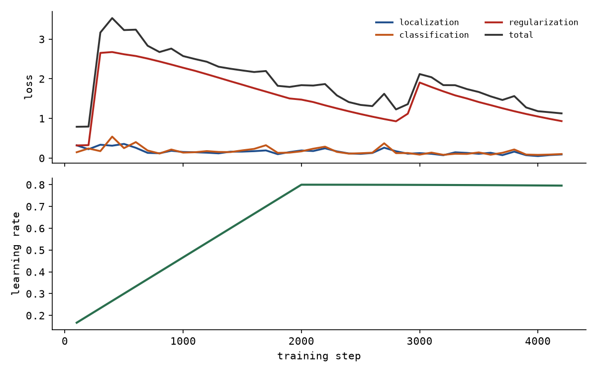
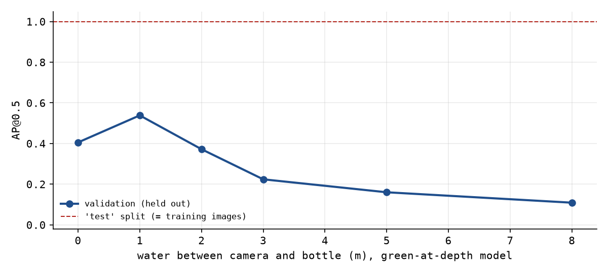
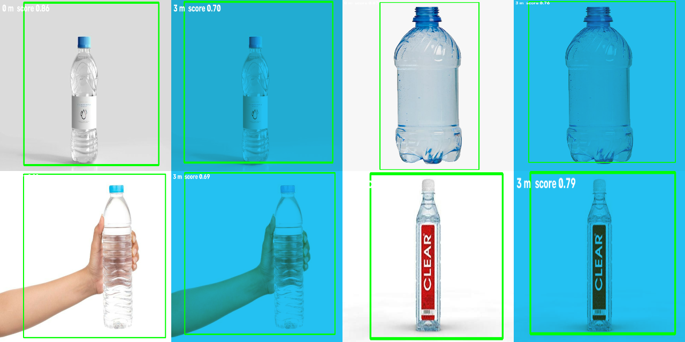

# interview-bottle

**The interview task, graded properly three years later.**

In December 2023 the BRACU Duburi underwater-robotics team gave applicants a
task: train an object detector. I took a Kaggle water-bottle dataset, labelled
it by hand in LabelImg, fine-tuned **SSD MobileNet v2 320×320** with the
TensorFlow Object Detection API, and sent in screenshots like this one:


*December 2023. "Bottle: 0.88". Very pleased. Look at how much wider than the
bottle that box is. That's not an accident, and it's the subject of this repo.*

The original README, with all seven screenshots, is kept in
[`README-2023.md`](README-2023.md). This repo re-opens the box with everything
the 2023 workspace left behind: the TensorBoard logs, the exported model and
the TFRecords.

## What the logs remember



- **15 training images.** Ten for validation. That's the whole dataset.
- **4,200 of 50,000 steps.** The run was stopped about 8 % of the way in.
- **A learning rate meant for someone else's computer.** The config came from the
  model zoo, where `learning_rate_base: 0.8` is tuned for a **batch of 512 on
  TPUs**. Here the batch was **8**. The linear scaling rule says it should
  have been about 0.8 × 8 / 512 ≈ **0.0125**. The warm-up climbs to 0.8 anyway,
  and the regularisation loss triples (0.32 → 0.93) as it does: the weights
  are being shoved around by steps 64× too big.

## The grade

`firstbottle/evaluate.py` re-scores the exported model. The first thing it
found was that the original test split isn't one:

> **`test.tfrecord` is a byte-for-byte copy of `train.tfrecord`.** All 15 "test"
> images are training images. On them the model scores AP@0.5 = **1.000**:
> memory, not skill.

So the honest held-out set is the 10 validation images:

| what | AP@0.5 |
|---|---:|
| "test" split (= training images) | 1.000 |
| **validation, never trained on** | **0.405** |
| logged by the 2023 eval job (validation, step 4000) | 0.506 |

Why so low, when the boxes *look* right? Because of the habit:

| median share of the frame | |
|---|---:|
| covered by the model's top box | **72 %** |
| covered by the real bottle (validation) | 31 % |
| covered by the real bottle (training) | 51 % |

Every training image is one product-shot bottle, front and centre, filling half
the frame. Fifteen times. The cheapest correct answer the network could learn
was "a big box in the middle", and it learned that very well.

## Would it have survived the pool?

This was an interview for an *underwater* team, so the last question is the
obvious one. The validation images go through the same water model as
[green-at-depth](https://github.com/fh1m/green-at-depth) (Beer–Lambert, pure-water
absorption ×4):



| water path | 0 m | 1 m | 2 m | 3 m | 5 m | 8 m |
|---|---:|---:|---:|---:|---:|---:|
| AP@0.5, validation | 0.405 | 0.538 | 0.372 | 0.224 | 0.160 | 0.109 |

(The bump at 1 m is ten images being ten images.)



Bottom right says it in one picture: the red **CLEAR** label is dark green at
3 m. Water eats red first. A detector trained on white-background product
shots has never seen that.

## What I'd change, and haven't

[`workspace/models/ssd_mobilenet/pipeline.fixed.config`](workspace/models/ssd_mobilenet/pipeline.fixed.config)
is the 2023 config with the fixes this repo argues for. **It has not been
retrained.** The numbers above are all from the 2023 model.

1. `learning_rate_base` 0.8 → 0.0125 (scaled to batch 8), warm-up 0.0025 over
   500 steps, 5,000 steps total, no 8-replica sync on a single GPU.
2. A real test split: the duplicated `test.tfrecord` is dropped, and validation is
   reported as the held-out number until there are new labelled images.
3. Augmentations that break the habit. 2023 already flipped and cropped; the fix
   adds `random_pad_image` (bottles small and off-centre) and hue, saturation and
   brightness jitter (closer to water).
4. Relative paths. The 2023 file pointed at `/home/fh1m/tmp/…`, a folder on the 2023
   laptop, and fine-tuned from its own earlier `ckpt-5`.

## Run it

```bash
python -m venv .venv && . .venv/bin/activate
pip install -r requirements.txt
python -m firstbottle.evaluate    # ~20 s on a CPU, prints the numbers, rewrites assets/*.png
```

## Layout

```
workspace/exported_models/ssd_mobilenet/   the 2023 model, as exported
workspace/models/ssd_mobilenet/            checkpoints, TensorBoard logs, configs
workspace/data/                            the TFRecords (and the label map)
workspace/test.py                          the 2023 inference script
firstbottle/evaluate.py                    the re-grade
assets/Results/                            the 2023 screenshots
README-2023.md                             the 2023 README
```

The TensorFlow model garden, cocoapi, protoc and the zoo checkpoint used to be
committed here too (~170 MB of other people's code). They're upstream's to
host: see the [TF2 Object Detection API install guide](https://github.com/tensorflow/models/blob/master/research/object_detection/g3doc/tf2.md).
